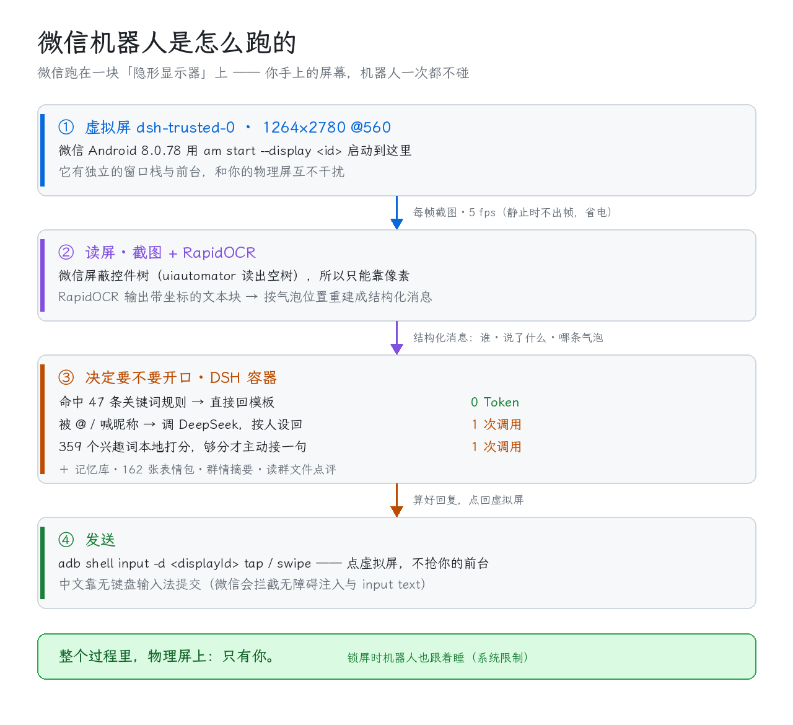
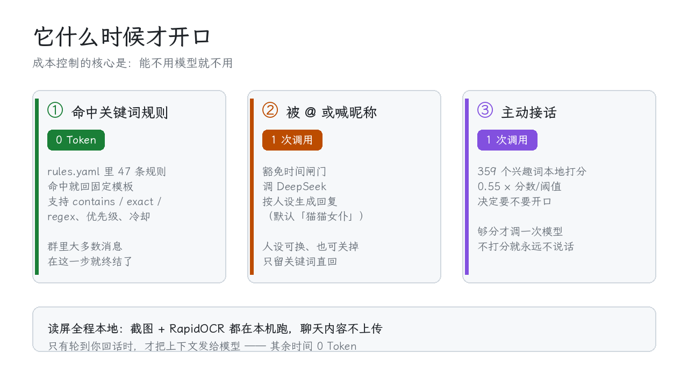

# 微信机器人 v2.1.3


> ## ⚠️ 使用前必读
> - 本项目**仅供技术学习研究**。使用它**可能违反微信的服务协议，导致账号被限制或封禁**，风险由使用者自负。
> - 与腾讯 / 微信**没有任何关系**；不修改微信客户端、不注入内存，只使用系统公开能力（无障碍、输入法、截图）操作界面。
> - **严禁**用于发送垃圾信息、骚扰他人、诈骗、侵犯隐私等场景。
> - 完整条款见 **[免责声明](DISCLAIMER.md)** —— 不同意就不要用。

**它跑在 Android 手机 + DSH 容器里：微信被启动到一块「虚拟屏」上，读屏靠截图 + OCR，
回复靠 DeepSeek 人设或关键词规则。你的物理屏全程不受影响，也不需要 root。**

**发布包自带 DSH 安装包与虚拟屏插件**（`dsh安装包/`），不用你满世界找环境件。



## 它特别在哪

| 常见做法 | 本项目 |
|---|---|
| 在你正拿着的手机上点来点去，你没法同时用 | 微信跑在**虚拟屏**（另一块逻辑显示器）上，物理屏只有你 |
| 靠控件树（uiautomator / 无障碍）读消息 | 微信**屏蔽控件树**，读出来是空树 → 改用**截图 + RapidOCR** 按气泡坐标重建 |
| 直接往输入框注入文字 | 微信**拦截注入**（无障碍 `ACTION_SET_TEXT`、`input text` 都进不去）→ 用**无键盘输入法**提交中文 |
| 每条消息都调一次大模型 | **47 条关键词规则先挡掉绝大多数**，被 @ 或话题对味才调模型 |



## 它能做什么

| 能力 | 说明 |
|---|---|
| 关键词直回 | `rules.yaml` 47 条规则，命中就回模板 —— **0 Token** |
| 被 @ / 喊昵称 | 按人设生成回复（默认「猫猫女仆」，五套人设可换） |
| **昵称名单（特别关注）** | 面板上填一份名单，名单上的人一说话就按「被 @」处理 —— 必回、旁边有图也照认、不受静默时段限制（配额照旧，防封号底线） |
| 主动接话 | 359 个兴趣词本地打分，够分才开口 —— 不刷屏 |
| 发表情包 | 162 张图，按标签随机挑 |
| 今日美图 / 看看腿 | 联网取图，或从你自己的本地图集里发 |
| 读群文件点评 | 群里发 PPT / PDF / Word / Excel，它读内容再点评 |
| 记忆库 | 记「人」和「梗」，回复时按相关性注入 |
| 群情摘要 | 每小时的群背景，超出 10 分钟窗也接得上话 |
| 交给 agent 办事 | 主人喊它办事时转发给 DSH agent（可关） |

## v2.1.x 主要变化

- **⭐ 昵称名单**：名单上的人一说话就按「被 @」处理，必回、不受静默时段与最小间隔限制。
- **画面冻结自愈**：读屏画面长时间不动时自己复核（再读标题 + 把微信搬到别的屏再搬回来），
  确认真冻了才提示，并附上「重建虚拟屏守护 → 重启桥接 → 把微信放回虚拟屏」的恢复步骤。
- **读屏漏消息修复**：屏幕最底部被截断的消息、被底部快捷栏静默吞掉的一整段消息，两处都已修好。
- **傻瓜式装机**：包内直接附带 `Tdsh-0.2.8.3.apk`（DSH 安装包）与 `dsh-vscreen-1.1.0.tgz`
  （虚拟屏插件）；攻略全部改成「把这句话复制给 AI」，不会敲命令也能装。
- **装机浮窗**：安装过程中，AI 把每一步指令推到屏幕边缘的浮窗上 —— 你低头就能看到，
  不用来回切窗口；一件做完 `hud --done`（亮屏 + 震动）。

细节见 [CHANGELOG.md](CHANGELOG.md)，玩法见 [功能介绍.md](功能介绍.md)。

## 装起来

**[⬇️ 下载安装包 · 傻瓜式一键安装（283 MB）](https://github.com/asyyy857/wechat-bot-android/releases/latest)**
（文件名 `wechat-bot-v2.1.3-one-click-install.zip`；发布包自带 DSH 安装包与虚拟屏插件）

```sh
cd /sdcard/Download && unzip wechat-bot-v2.1.3-one-click-install.zip -d /sdcard/dsh/
cd /sdcard/dsh/微信机器人-v2.1.3
sh install.sh          # ⚠️ 必须 sh 开头，/sdcard 是 noexec
```

**不想敲命令？** 把 DSH 装好后，对它里面的 AI 说一句：

> **读安装任务书，带我装**

它会全程一步步带你，你只要跟着手机提示操作 + 回一句「好了」即可。

## 先读哪份

| 文档 | 内容 |
|---|---|
| [新手安装攻略-从零开始.md](新手安装攻略-从零开始.md) | **完全没装过就先看这份**（傻瓜版）：装 DSH → 注册 DeepSeek 取 Key → 连 adb → 装机器人；不用会敲命令 |
| [给AI的安装任务书.md](给AI的安装任务书.md) | **写给 DSH 里 AI 看的安装任务书**：一句话交给它，它全程带用户装完；装机过程会用**浮窗**把指令递到用户眼前 |
| [复制给AI的话术.md](复制给AI的话术.md) | **一节一句、可直接长按复制**的 AI 话术清单（装 / 连 adb / USB 备用 / 验收 / 日常 / 排障 / 升级） |
| [快速开始.md](快速开始.md) | **入口**：前置条件、目录结构、安装三步、日常开关、升级与回滚 |
| [功能介绍.md](功能介绍.md) | 它有哪些能力、每个功能怎么配 |
| [配置手册.md](配置手册.md) | `config.yaml` 每一项的含义 + 常用调参配方 |
| [字体与OCR.md](字体与OCR.md) | 微信不是默认字体 / 想调识别时看这份 |
| [虚拟屏与技术.md](虚拟屏与技术.md) | 虚拟屏规格、原理、踩过的坑（含一次真实事故复盘） |
| [受信任虚拟屏自动化后台运行-v1.1.md](受信任虚拟屏自动化后台运行-v1.1.md) | **进阶参考**：虚拟屏 + shell 守护整套方案（架构、通道、从零重建，文末自带全部源码） |
| [排障手册.md](排障手册.md) | 出问题先查这里 |
| [CHANGELOG.md](CHANGELOG.md) | 版本改动 |

## 目录约定

- `payload/` —— 要安装的东西（程序 + 环境件 + OCR 运行时，大文件走 Release 附件）
- `dsh安装包/` —— 附带的 **DSH 安卓安装包 + 虚拟屏插件**（**不是**机器人本体，是它依赖的环境件）
- `install.sh` —— 安装 / 升级程序（`sh install.sh --dry-run` 可先看它要做什么）
- 装完之后：程序在 `/sdcard/dsh/wechat-bot/app`、**你的数据在 `.../data`**、日志在 `.../logs`
- 升级只覆盖 `app/`，配置、聊天流水、记忆库、表情包一个都不会丢

## 前置条件（包里带不了的）

| 前提 | 说明 |
|---|---|
| Android 11+ 手机 | 需要「虚拟屏」能力 |
| **DSH App**（Android 上的 Linux 容器） | 机器人本体跑在里面 —— **包内 `dsh安装包/Tdsh-0.2.8.3.apk` 已经带了** |
| **无线调试**可用 | 读屏 / 点击走 `adb`，要能打开「开发者选项 → 无线调试」 |
| **Shizuku** 已授权 | 虚拟屏守护靠它建屏 |
| 会敲一点点命令 | 不用了 —— 攻略已改成「复制一句话给 AI」 |

> 💡 包内附带的环境件放在顶层 `dsh安装包/`：`Tdsh-0.2.8.3.apk`（DSH）与
> `dsh-vscreen-1.1.0.tgz`（虚拟屏插件），装法与已知坑见该目录下的 `说明.txt`。
>
> 🖱️ **不想敲命令？** 装好 DSH 后对它说「读安装任务书，带我装」。
> 🔌 **无线调试连不上？** 攻略里有「**USB 调试 + 电脑**」的备选路（做一次 USB 后
> `adb tcpip 5555` 让容器直连、拔线继续跑）。
>
> ⚠️ 包内附带的 APK 与插件由第三方提供，请自行确认来源可信；本项目与其开发者没有关联。

## 适配

微信 Android **8.0.78**（2026-10-13 实测）。微信大版本更新后读屏可能失效，
届时看《排障手册.md》。

## 许可

[MIT](LICENSE)
